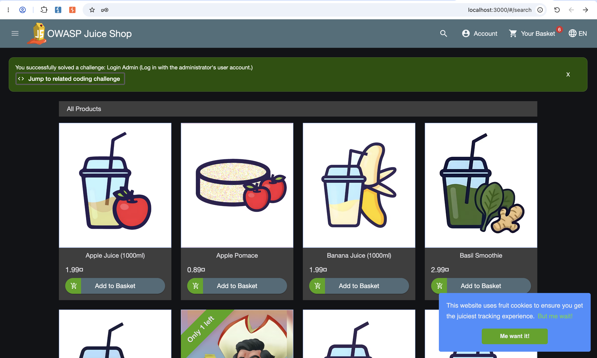
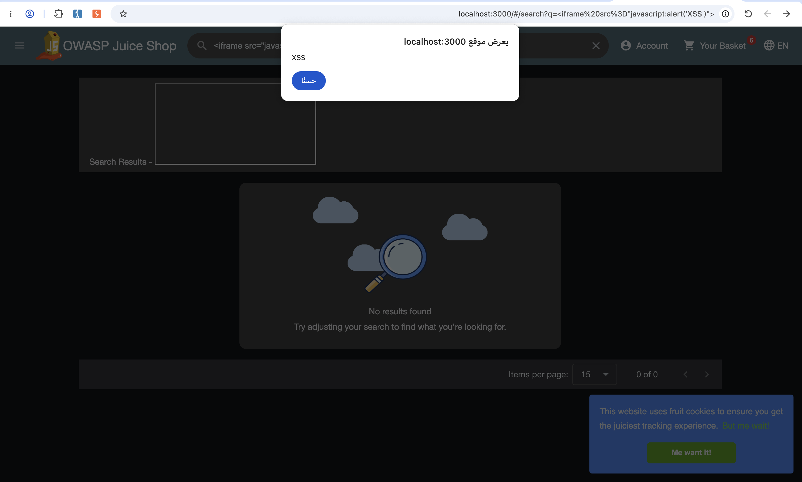
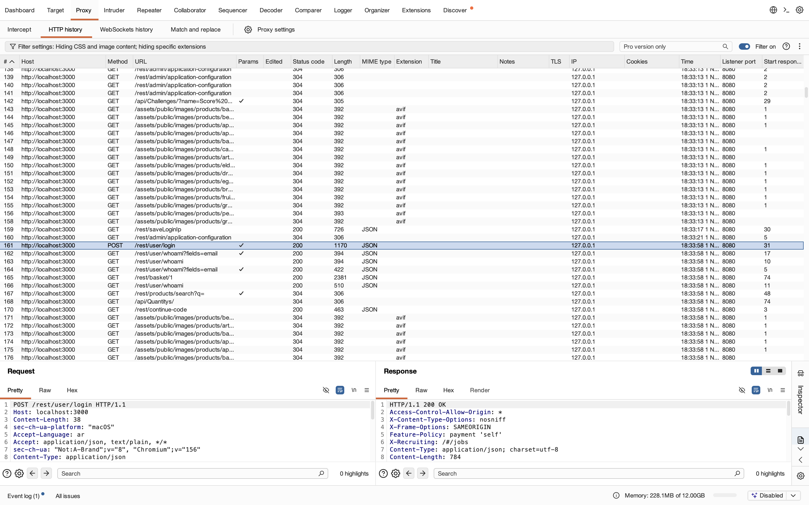

# Evidence Documentation

This folder contains screenshots collected during the security assessment of OWASP Juice Shop.

## 1. SQL Injection Login Test

The screenshot below documents the successful login observation during the SQL Injection test.

## 2. Cross-Site Scripting (XSS)

The screenshot below shows the JavaScript alert dialog observed during the search test.

## 3. Burp Suite HTTP Traffic Analysis

The screenshot below shows the HTTP login request and server response captured using Burp Suite Community Edition.

